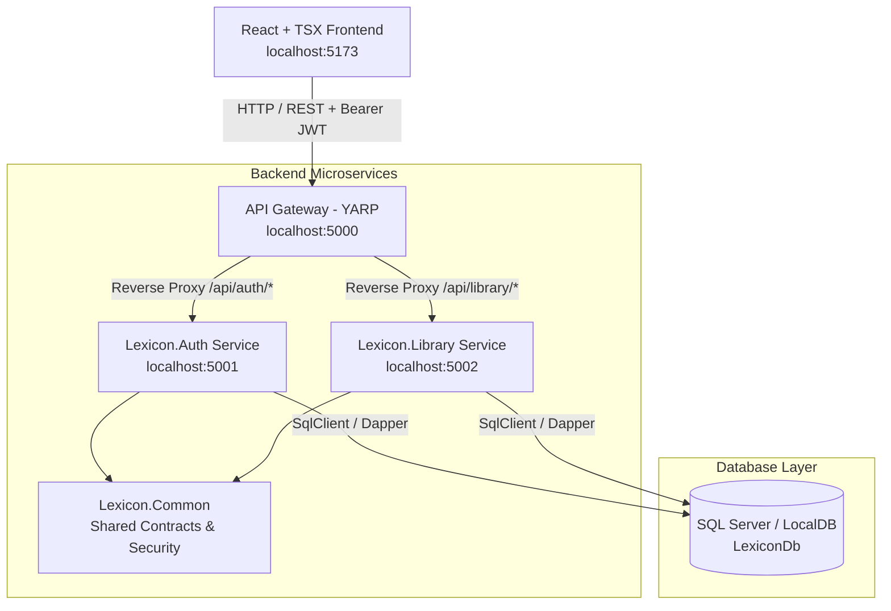

# LEXICON — Microservices Architecture Platform

> **A high-performance personal lexicography and social vocabulary platform built with a .NET 9 microservice backend, YARP API Gateway, idempotent SQL Server schema, and a modern React + TypeScript (TSX) interface.**

---

## Table of Contents
1. [Project Concept & Vision](#1-project-concept--vision)
2. [High-Level Architecture](#2-high-level-architecture)
   - [System Context & Architecture Diagram](#system-context--architecture-diagram)
   - [Microservices Roster & Port Allocations](#microservices-roster--port-allocations)
   - [API Gateway Pattern (YARP)](#api-gateway-pattern-yarp)
   - [Security & Authentication Model](#security--authentication-model)
3. [Low-Level Architecture](#3-low-level-architecture)
   - [Database Schema & Idempotent Strategy](#database-schema--idempotent-strategy)
   - [Personal Dictionary Model (Words & Phrases)](#personal-dictionary-model-words--phrases)
   - [Alphabetical Sorting Engine](#alphabetical-sorting-engine)
   - [Datetime Filtering Mechanism](#datetime-filtering-mechanism)
   - [API Endpoints Reference](#api-endpoints-reference)
4. [Prerequisites & Requirements](#4-prerequisites--requirements)
5. [Step-by-Step Setup & Execution](#5-step-by-step-setup--execution)
   - [Step 1: Execute Database Schema Script](#step-1-execute-database-schema-script)
   - [Step 2: Configure Connection Strings](#step-2-configure-connection-strings)
   - [Step 3: Launch Microservices & Frontend](#step-3-launch-microservices--frontend)
6. [Pre-Seeded Demo Accounts](#6-pre-seeded-demo-accounts)
7. [Social & Chat Roadmap](#7-social--chat-roadmap)

---

## 1. Project Concept & Vision

**LEXICON** transforms personal vocabulary collecting into a structured, social experience:
- **Registration / Login & Identity**: Secure authentication issuing signed JWT tokens with claims-based access.
- **Personal Dictionary Creation**: Every user curates their own private or public dictionary divided into two distinct tabs:
  - **Words Tab**: Individual vocabulary terms, definitions, parts of speech (noun, verb, adjective, etc.), example sentences, tags, and etymological notes.
  - **Phrases Tab**: Figurative idioms, conversational expressions, meanings, and real-life dialogue contexts.
- **Automatic Alphabetical Sorting**: All words and phrases are automatically sorted alphabetically (A &rarr; Z) using SQL collation, accompanied by an interactive quick-jump A-Z index bar.
- **Datetime Filtering**: Filter entries by custom date windows or presets (Today, Past 7 Days, Past 30 Days) to review what was learned over time.
- **Interactive Audio**: Native speech synthesis integration to pronounce any word or phrase directly in the browser.
- **Community Exploration**: Browse other users' public libraries, view their curated language collections, and prepare for upcoming peer-to-peer social features (friendships and direct messaging).

---

## 2. High-Level Architecture

### System Context & Architecture Diagram



### Microservices Roster & Port Allocations

| Component | Technology | Port | Responsibilities |
|---|---|---|---|
| **Lexicon.Gateway** | ASP.NET Core 9 / YARP | `5000` | Unified API entrypoint, reverse proxy routing, CORS aggregation, centralized logging |
| **Lexicon.Auth** | ASP.NET Core 9 Web API | `5001` | User registration, login, PBKDF2 password hashing, JWT issue, user profiles, community user search |
| **Lexicon.Library** | ASP.NET Core 9 Web API | `5002` | Words CRUD, Phrases CRUD, alphabetical collation sorting, datetime filtering, library metrics |
| **Lexicon.Common** | .NET 9 Class Library | N/A | DTO contracts, `ApiResponse<T>`, `PagedResult<T>`, JWT generator, password hasher |
| **Frontend** | React 19, TypeScript, Vite | `5173` | Dark glassmorphic responsive UI, Web Speech API pronunciation, tabs, date filtering |
| **Database** | SQL Server (T-SQL) | `1433` (or LocalDB) | Relational storage with non-clustered indexes for alphabetical and date queries |

### API Gateway Pattern (YARP)
Instead of requiring the client to communicate with multiple service endpoints across different ports, the **YARP (Yet Another Reverse Proxy)** API Gateway exposes a unified origin (`http://localhost:5000`):
- `/api/auth/{**catch-all}` is routed to `http://localhost:5001`
- `/api/library/{**catch-all}` is routed to `http://localhost:5002`
- Handles preflight CORS requests for modern single-page applications.

### Security & Authentication Model
- **Password Protection**: Hashed using industry-standard **PBKDF2** with HMAC-SHA256, 16-byte cryptographically secure random salt, and 100,000 iterations.
- **Stateless Tokens**: Signed JWTs containing `ClaimTypes.NameIdentifier` (User GUID), `ClaimTypes.Name`, and `ClaimTypes.Email`.
- **Authorization**: Protected endpoints in microservices utilize the `[Authorize]` attribute validated via `Microsoft.AspNetCore.Authentication.JwtBearer`.

---

## 3. Low-Level Architecture

### Database Schema & Idempotent Strategy
Database changes are maintained in a **single idempotent script**:
```
database/schema.sql
```
Every table, index, foreign key, and seed record is guarded by existence checks (`IF NOT EXISTS`). This guarantees that:
1. You can execute the entire script repeatedly without errors or duplicating records.
2. New tables, columns, or indexes can be added directly to this file, maintaining a single source of truth for database tracking.

#### Tables Provisioned:
- **`Users`**: Primary key `Id` (GUID), `Username`, `Email`, `PasswordHash`, `FullName`, `Bio`, `AvatarUrl`, `IsPublic`, `CreatedAt`, `UpdatedAt`.
- **`Words`**: `Id` (GUID), `UserId` (FK), `Term`, `Definition`, `PartOfSpeech`, `ExampleSentence`, `Tags`, `Notes`, `IsPublic`, `CreatedAt`, `UpdatedAt`.
- **`Phrases`**: `Id` (GUID), `UserId` (FK), `PhraseText`, `Meaning`, `Context`, `Tags`, `Notes`, `IsPublic`, `CreatedAt`, `UpdatedAt`.
- **`Friendships`**: Ready for social expansion (`RequesterId`, `AddresseeId`, `Status`).
- **`ChatMessages`**: Ready for real-time messaging (`SenderId`, `ReceiverId`, `MessageText`, `SentAt`, `IsRead`).

#### Dedicated Performance Indexes:
```sql
IX_Words_UserId_Term        ON Words (UserId ASC, Term ASC)
IX_Words_CreatedAt          ON Words (CreatedAt DESC)
IX_Phrases_UserId_PhraseText ON Phrases (UserId ASC, PhraseText ASC)
IX_Phrases_CreatedAt        ON Phrases (CreatedAt DESC)
```

### Personal Dictionary Model (Words & Phrases)
The platform cleanly separates individual lexemes (words) from multi-word expressions (phrases):
- **Words Tab**: Focuses on precise semantic definitions, formal grammatical classification (`noun`, `verb`, `adjective`, etc.), and exemplary usage.
- **Phrases Tab**: Focuses on idiomatic expressions, conversational meaning, and pragmatic conversational context.

### Alphabetical Sorting Engine
By default, queries execute with automatic alphabetical sorting:
```sql
-- Words Sorting (Case-Insensitive Collation)
ORDER BY Term COLLATE Latin1_General_CI_AS ASC

-- Phrases Sorting
ORDER BY PhraseText COLLATE Latin1_General_CI_AS ASC
```
Users can also toggle reverse alphabetical (Z &rarr; A), newest first, or oldest first.

### Datetime Filtering Mechanism
The system tracks timestamps with time zone awareness (`DATETIMEOFFSET`). The backend filters:
```sql
WHERE CreatedAt >= @FromDate AND CreatedAt <= @ToDate
```
The frontend supports preset filters:
- **All Time** (unrestricted)
- **Today** (start of current day to present)
- **Past 7 Days** (sliding 7-day window)
- **Past 30 Days** (sliding 30-day window)
- **Custom Range** (explicit Start and End date pickers)

### API Endpoints Reference

All requests pass through the Gateway on port `5000`:

#### Authentication (`/api/auth`)
| Method | Path | Auth | Description |
|---|---|---|---|
| `POST` | `/api/auth/register` | Anonymous | Register a new user |
| `POST` | `/api/auth/login` | Anonymous | Authenticate and obtain JWT token |
| `GET` | `/api/auth/me` | Bearer JWT | Retrieve current authenticated user profile |
| `GET` | `/api/auth/users` | Anonymous | Search and list community members |
| `GET` | `/api/auth/users/{id}` | Anonymous | Get public profile of a user |

#### Library & Dictionary (`/api/library`)
| Method | Path | Auth | Description |
|---|---|---|---|
| `GET` | `/api/library/words` | Optional | Get words (alphabetical sort, datetime filter, letter filter, search) |
| `GET` | `/api/library/words/{id}` | Optional | Get single word details |
| `POST` | `/api/library/words` | Bearer JWT | Add new word to authenticated user's dictionary |
| `PUT` | `/api/library/words/{id}` | Bearer JWT | Edit existing word (owner only) |
| `DELETE` | `/api/library/words/{id}` | Bearer JWT | Delete word (owner only) |
| `GET` | `/api/library/phrases` | Optional | Get phrases (alphabetical sort, datetime filter, search) |
| `GET` | `/api/library/phrases/{id}` | Optional | Get single phrase details |
| `POST` | `/api/library/phrases` | Bearer JWT | Add new phrase to authenticated user's library |
| `PUT` | `/api/library/phrases/{id}` | Bearer JWT | Edit existing phrase (owner only) |
| `DELETE` | `/api/library/phrases/{id}` | Bearer JWT | Delete phrase (owner only) |
| `GET` | `/api/library/summary` | Bearer JWT | Get authenticated user's dictionary statistics |
| `GET` | `/api/library/summary/{userId}` | Optional | Get specified user's public dictionary statistics |

---

## 4. Prerequisites & Requirements

- **.NET SDK**: .NET 9.0 (or .NET 10 preview) installed.
- **Node.js**: v18+ (tested on Node v24 with npm 11).
- **Microsoft SQL Server**: LocalDB, SQL Server Express, or Developer edition running on `localhost`.
- **SQLCMD**: Installed by default with SQL Server or SSMS tools.

---

## 5. Step-by-Step Setup & Execution

### Step 1: Execute Database Schema Script
Run the idempotent SQL script against your local SQL Server instance using the included PowerShell script:

```powershell
# For default localhost SQL Server:
.\scripts\migrate_db.ps1

# Or specify a custom instance (e.g. SQLEXPRESS or LocalDB):
.\scripts\migrate_db.ps1 -Server ".\SQLEXPRESS"
# or
.\scripts\migrate_db.ps1 -Server "(localdb)\mssqllocaldb"
```

*Alternatively, open [database/schema.sql](file:///c:/Users/Khushmanpreet/Desktop/Projects/lexicon/database/schema.sql) in SQL Server Management Studio (SSMS) or Azure Data Studio and click **Execute**.*

### Step 2: Configure Connection Strings
The default connection string in both `backend/src/Lexicon.Auth/appsettings.json` and `backend/src/Lexicon.Library/appsettings.json` is:
```json
"ConnectionStrings": {
  "DefaultConnection": "Server=localhost;Database=LexiconDb;Trusted_Connection=True;TrustServerCertificate=True;"
}
```
If you are using SQL Server Express or LocalDB, simply adjust the `Server` parameter:
- SQL Server Express: `Server=.\\SQLEXPRESS;Database=LexiconDb;Trusted_Connection=True;TrustServerCertificate=True;`
- LocalDB: `Server=(localdb)\\mssqllocaldb;Database=LexiconDb;Trusted_Connection=True;TrustServerCertificate=True;`

### Step 3: Launch Microservices & Frontend

#### Option A: Quick Launcher (All Services in 1 Command)
Run the automated launcher script to open 4 separate terminals for Gateway, Auth, Library, and Frontend:
```powershell
.\scripts\start_all.ps1
```

#### Option B: Manual Terminal Execution
Open 4 terminal tabs:

**Terminal 1 — Auth Service:**
```bash
cd backend/src/Lexicon.Auth
dotnet run
# Runs on http://localhost:5001
```

**Terminal 2 — Library Service:**
```bash
cd backend/src/Lexicon.Library
dotnet run
# Runs on http://localhost:5002
```

**Terminal 3 — API Gateway:**
```bash
cd backend/src/Lexicon.Gateway
dotnet run
# Runs on http://localhost:5000
```

**Terminal 4 — React Frontend:**
```bash
cd frontend
npm run dev
# Opens on http://localhost:5173
```

Navigate your browser to: **`http://localhost:5173`**

---

## 6. Pre-Seeded Demo Accounts

The idempotent SQL script includes two ready-to-use accounts with curated vocabularies:

### 1. Primary Demo Account:
- **Username**: `demo`
- **Email**: `demo@lexicon.app`
- **Password**: `Password123!`
- *Pre-loaded words*: Serendipity, Ephemeral, Petrichor, Mellifluous, Sonder.
- *Pre-loaded phrases*: Bite the bullet, Burn the midnight oil, A blessing in disguise.
- *(In the UI login modal, click the **"Fill Demo"** button to auto-fill these credentials instantly!)*

### 2. Community Explorer Member:
- **Username**: `sophia_reads`
- **Full Name**: Sophia Reynolds
- *Pre-loaded content*: Halcyon, Through thick and thin.
- *(Explore Sophia's library by clicking the **"Explore Members"** tab!)*

---

## 7. Social & Chat Roadmap

The foundational schema tables (`Friendships` and `ChatMessages`) are already created in the database. Future iterations will add:
1. **`Lexicon.Social` Microservice**: Manage friend requests, status transitions (`PENDING`, `ACCEPTED`), and follower feeds.
2. **`Lexicon.Chat` Microservice**: Real-time two-way messaging using **ASP.NET Core SignalR** websockets routed through the YARP gateway.
3. **Shared Collections**: Ability to fork or bookmark words and phrases from other curators into your own personal dictionary.


how to run :
 .\scripts\start_all.ps1